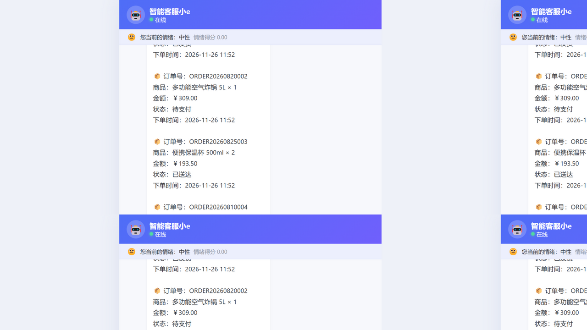
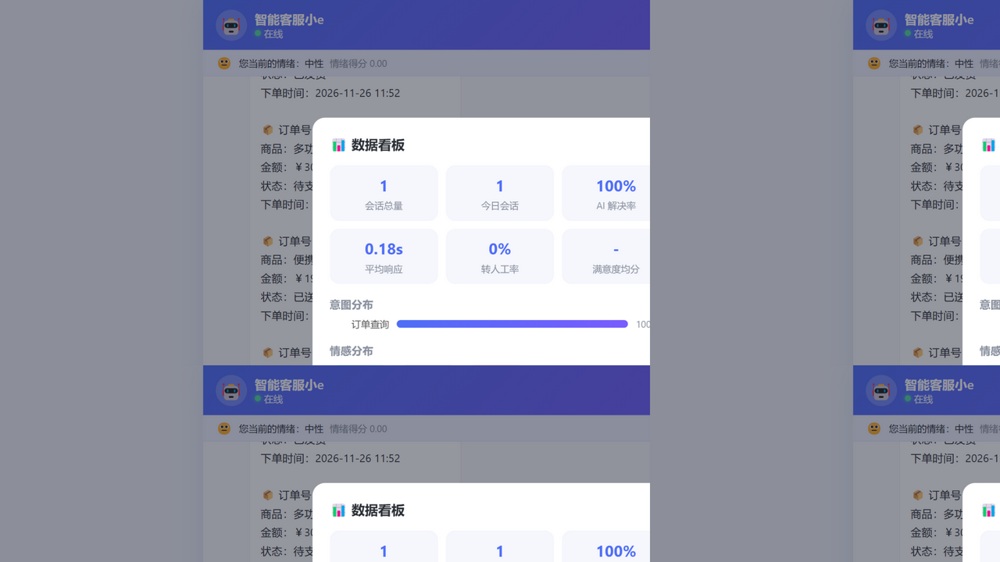

<div align="center">

# 🛒 E-commerce Support Agent

**A ReAct customer-service agent with 3-way intent fusion, sentiment-aware escalation, RAG, and anti-hallucination guardrails. Runs with — or without — an API key.**


[](https://github.com/xionghuazhou/ecommerce-support-agent/actions/workflows/ci.yml)
[](https://github.com/xionghuazhou/ecommerce-support-agent/releases)
[](CONTRIBUTING.md)

**English** | [简体中文](README.zh-CN.md)



*A real order-query conversation showing intent, sentiment and the query_order tool call.*

</div>

---

## 💡 What is this?

A production-shaped e-commerce customer service system: **LLM + ReAct Agent + RAG + NLU intent recognition + sentiment analysis**. The agent understands what the customer wants (3-way intent fusion), feels how they feel (sentiment scoring with automatic human escalation), and acts through 8 business tools — while **5 reliability guardrails** keep a small model from hallucinating order numbers, refunding the wrong order, or claiming success when a tool failed.

No API key? The whole pipeline still runs: template replies + local hash embeddings, zero dead ends.

## ✨ Features

| Capability | Description |
|---|---|
| 🤖 **ReAct Agent** | Thought → Action → Observation loop, autonomously calling **8 business tools** |
| 🏷️ **3-way NLU fusion** | Keywords + embedding semantics + LLM understanding; 3 categories, 18 intents |
| ❤️ **Sentiment analysis** | Dictionary + rules in real time; negative sentiment gets empathy-first replies and auto-suggests human transfer below threshold |
| 📚 **RAG** | bge-m3 embeddings + cosine retrieval over the policy/FAQ knowledge base |
| 🔧 **8 tools** | knowledge search / order query / product query / refund & return / logistics tracking / web search / human transfer / ticket creation |
| 📊 **Analytics dashboard** | sessions, AI resolution rate, transfer rate, intent distribution, sentiment distribution, satisfaction |
| 🛡️ **5 anti-hallucination guardrails** | see below — the core differentiator |
| 🔌 **No-key degradation** | LLM/embedding unavailable → template replies + local hash vectors, full pipeline stays up |

## 🛡️ Reliability Guardrails

Built from real failure modes observed when running small models:

1. **Order numbers come from the user's own words** — regex-extracted from the original message, so a model mis-copying a long digit string can't query/refund the wrong order.
2. **Numeric consistency check** — every number in the reply must be traceable to a tool result or the user's message; otherwise the reply falls back to the tool's raw text.
3. **Fabrication interception** — if a tool returned failure but the model claims success, the Observation text overrides it.
4. **Policy-question protection** — *"what is your return policy?"* never triggers action tools like refund/cancel.
5. **No-key degradation** — the system never hard-fails when the LLM or embedding API is down.

## 🧠 Processing Pipeline

```
user message → preprocessing → sentiment analysis (dictionary + rules)
            → NLU intent (keywords + embedding + LLM fusion)
            → route: rag → RAG retrieval + LLM generation
                     tool → ReAct tool loop
                     transfer → human handoff
                     llm → direct reply
            → numeric consistency check (anti-fabrication)
            → sentiment-aware wrapping → persist → respond
```

## 🚀 Quick Start

> Python 3.11+. An OpenAI-compatible API key is recommended but **optional** — the system degrades gracefully without one.

```bash
cd backend

# 1. Install dependencies
python -m venv .venv
source .venv/bin/activate        # Windows: .venv\Scripts\activate
pip install -r requirements.txt

# 2. Configure (project ROOT .env)
cp ../.env.example ../.env       # Windows: copy ..\.env.example ..\.env
#    → fill in LLM_API_KEY (or leave it empty to try no-key mode)

# 3. Initialize DB (18 intents + demo products/orders + knowledge base vectorization)
python scripts/init_db.py

# 4. Launch (serves API + chat UI on a single port)
python -m uvicorn app.main:app --host 127.0.0.1 --port 8000
```

Open **http://127.0.0.1:8000/** — chat UI and API docs (`/docs`) on the same port.

**Windows one-click**: double-click `启动客服系统.bat` (requires a pre-created venv) or `打开智能助手.bat` (hidden-window auto-start + health wait + opens browser).

### Smoke test

```bash
# With the server running, in another terminal:
python scripts/test_api.py       # 6 end-to-end conversation scenarios
```

## 💬 Demo Conversations

| You say | What happens |
|---|---|
| Where is my order ORDER20260815001? | intent=order query, order number regex-extracted, ReAct calls `query_order` → logistics info |
| Cancel ORDER20260820002, I don't want it | intent=cancel order, `refund` tool actually mutates order state |
| What's your return policy? | intent=after-sales policy, RAG answers from knowledge base verbatim (zero numeric drift) |
| Recommend some headphones | intent=product consultation, RAG hits product FAQ |
| This thing is terrible, I want to complain! | sentiment=negative (-0.57), intent=complaint, auto human transfer with queue position |

Demo account `demo_user` (ID=1) owns 4 orders in different states for querying/operating.

## 📸 Analytics Dashboard



## 📌 Limitations

- Orders, products and customers are demo data; no real payment, refund or logistics system is modified.
- Without an embedding API key, local hash vectors provide degradation rather than true semantic embeddings.
- The chat UI is currently Chinese; an English UI is on the roadmap.

## ⚙️ Configuration

Copy `.env.example` to `.env` in the project root:

| Key | Description | Default |
|---|---|---|
| `LLM_API_KEY` | OpenAI-compatible key (empty = no-key mode) | — |
| `LLM_BASE_URL` | OpenAI-compatible endpoint | `https://api.siliconflow.cn/v1` |
| `LLM_MODEL` | Any compatible chat model | `Qwen/Qwen2.5-7B-Instruct` |
| `EMBEDDING_MODEL` | Embedding model for RAG | `BAAI/bge-m3` |
| `AGENT_MAX_ITERATIONS` | Max ReAct loops per message | `5` |
| `AUTO_TRANSFER_SENTIMENT_THRESHOLD` | Auto-transfer below this sentiment score | `-0.5` |
| `INTENT_THRESHOLD` | Intent confidence threshold | `0.6` |

> Developed and tested with `deepseek-ai/DeepSeek-V4-Flash` on SiliconFlow; any OpenAI-compatible chat model works.

## 📁 Project Structure

```
├── .env.example               # Configuration template
├── knowledge_base/faqs.json   # Knowledge base source
├── frontend/static/           # Vue 3 + Pinia CDN single-page chat UI (zero build)
│   ├── index.html / app.js / style.css
│   └── vendor/                # Localized Vue / Pinia (no CDN needed at runtime)
└── backend/
    ├── app/
    │   ├── main.py            # FastAPI entry (lifespan: auto schema + vector index)
    │   ├── core/              # config (pydantic-settings) / database (SQLite async)
    │   ├── models/            # 8 tables: users/sessions/messages/intents/knowledge/orders/products/tickets
    │   ├── schemas/           # Pydantic request/response models
    │   ├── services/          # llm / embedding / intent / sentiment / rag / cache
    │   ├── agents/
    │   │   ├── base_agent.py      # Tool registry / state / history
    │   │   ├── customer_agent.py  # ReAct loop + intent routing + sentiment strategy + guardrails
    │   │   ├── prompts/           # System prompt + tool JSON schemas
    │   │   └── tools/             # 8 business tools
    │   └── api/v1/            # chat / intent / knowledge / order / product / analytics
    └── scripts/               # init_db / import_knowledge / seed_data / test_api
```

## 🧩 Design Decisions (lightweight by intent)

| Heavyweight option | This project | Why |
|---|---|---|
| MySQL | SQLite (aiosqlite) | zero database service to install |
| Redis | in-process cache | enough for a single-node demo |
| Milvus | numpy cosine similarity | vectors persisted locally, no extra service |
| Vue3 + Vite + Node | Vue3 + Pinia via local vendor files | zero Node.js install, zero build step |

## 🛠️ Engineering Highlights

1. **Guardrails over prompts** — reliability enforced in code (regex extraction, numeric tracing, observation override), not just hoped for in the system prompt.
2. **3-way intent fusion** — keywords for speed, embeddings for semantics, LLM for the long tail; confidence-thresholded routing.
3. **Sentiment-driven policy** — empathy-first wrapping and threshold-based human escalation, not an afterthought.
4. **Full no-key degradation** — every external dependency has a local fallback.
5. **Clean layering** — api/v1 + schemas + services + agents, with an end-to-end smoke test script.

## 🗺️ Roadmap

- [ ] Screenshots / demo GIF
- [ ] pytest unit tests for guardrails and intent fusion
- [ ] Dockerfile + compose for one-command deployment
- [ ] English chat UI

## 🤝 Contributing

Issues and PRs are welcome! Please open an issue first for major changes.

## 📄 License

[MIT](LICENSE)

## 🙏 Acknowledgments

This project started as a reproduction of a public LLM-Agent development course project and was substantially reworked and extended by the author (see [Engineering Highlights](#-engineering-highlights)). Credit to the original course for the initial concept. Not affiliated with the course author.

<!--
After pushing to GitHub, uncomment to show star growth:

[](https://star-history.com/#xionghuazhou/ecommerce-support-agent&Date)
-->
