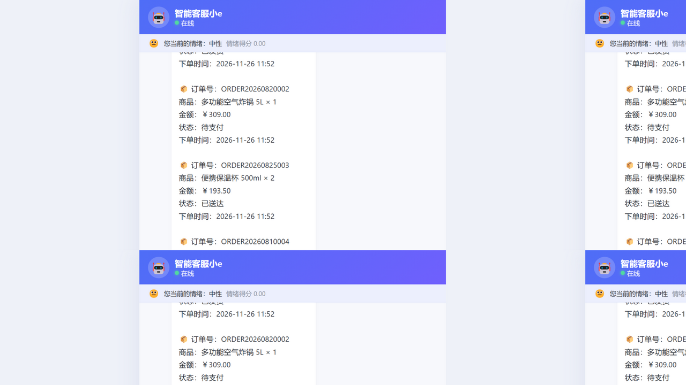
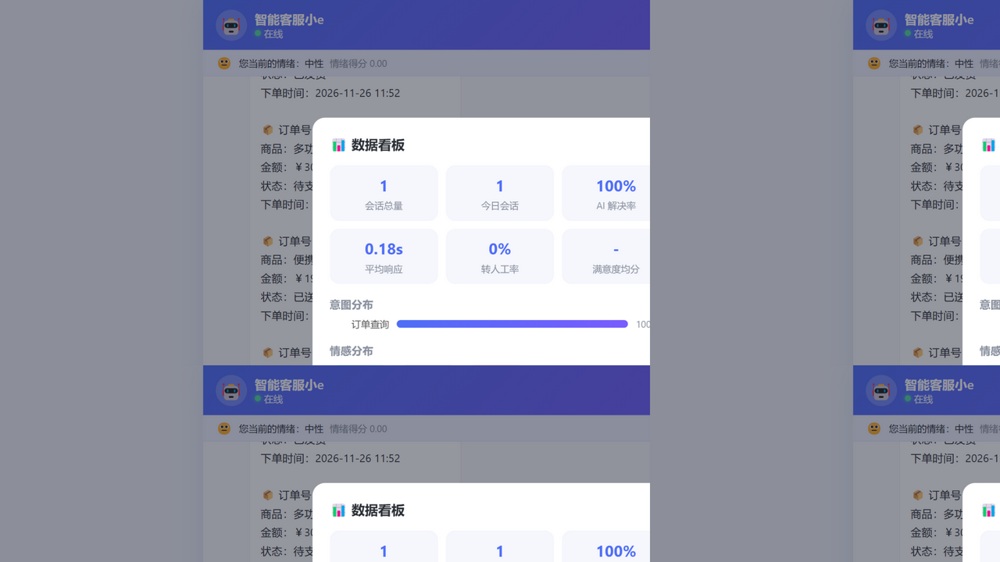

<div align="center">

# 🛒 电商智能客服 Agent

**ReAct 客服智能体：三路融合意图识别 + 情感感知转人工 + RAG + 反幻觉护栏。有无 API Key 都能跑。**


[](https://github.com/xionghuazhou/ecommerce-support-agent/actions/workflows/ci.yml)
[](https://github.com/xionghuazhou/ecommerce-support-agent/releases)
[](CONTRIBUTING.md)

[English](README.md) | **简体中文**



*真实订单查询对话：展示意图、情感和 query_order 工具调用。*

</div>

---

## 💡 这是什么？

一个生产形态的电商智能客服系统：**LLM + ReAct Agent + RAG + NLU 意图识别 + 情感分析**。智能体理解客户想要什么（三路融合意图识别）、感知客户情绪（情感打分 + 自动转人工），并通过 8 个业务工具采取行动——同时 **5 条可靠性护栏**防止小模型抄错订单号、退错订单、或在工具失败时谎称成功。

没有 API Key？全链路照样运行：模板回复 + 本地哈希向量，零死胡同。

## ✨ 核心能力

| 能力 | 说明 |
|---|---|
| 🤖 **ReAct Agent** | Thought → Action → Observation 循环，自主决策调用 **8 个业务工具** |
| 🏷️ **三路 NLU 融合** | 关键词 + Embedding 语义 + LLM 理解；3 大类 18 个意图 |
| ❤️ **情感分析** | 词典 + 规则实时感知；消极情绪安抚优先，低于阈值自动建议转人工 |
| 📚 **RAG** | bge-m3 向量化 + 余弦检索政策/FAQ 知识库 |
| 🔧 **8 个工具** | 知识检索 / 订单查询 / 商品查询 / 退款退货 / 物流查询 / 联网搜索 / 转人工 / 创建工单 |
| 📊 **数据看板** | 会话量、AI 解决率、转人工率、意图分布、情感分布、满意度 |
| 🛡️ **5 条反幻觉护栏** | 见下文——核心差异化 |
| 🔌 **无 Key 降级** | LLM/Embedding 不可用 → 模板回复 + 本地哈希向量，全链路不中断 |

## 🛡️ 可靠性护栏

来自小模型实测中观察到的真实失败模式：

1. **订单号以用户原话为准** — 从原始消息正则提取，模型抄错长数字串也不会查错/退错订单。
2. **数字一致性校验** — 回复中的每个数字必须能在工具结果或用户原话中溯源，否则回退工具原文。
3. **编造拦截** — 工具返回失败但模型声称成功时，用 Observation 原文纠正。
4. **政策问句保护** — *"退换货政策是什么？"* 绝不会误触发退款/取消等动作型工具。
5. **无 Key 降级** — LLM 或 Embedding API 挂掉时系统永不硬失败。

## 🧠 处理链路

```
用户消息 → 预处理 → 情感分析（词典 + 规则）
        → NLU 意图识别（关键词 + Embedding + LLM 融合）
        → 路由: rag → RAG 检索 + LLM 生成
                tool → ReAct 工具循环
                transfer → 转人工
                llm → 直接回复
        → 数字一致性校验（反编造）
        → 情感策略包装 → 存库 → 返回前端
```

## 🚀 快速开始

> Python 3.11+。推荐配置 OpenAI 兼容 API Key，但**非必需**——无 Key 时系统优雅降级。

```bash
cd backend

# 1. 安装依赖
python -m venv .venv
source .venv/bin/activate        # Windows: .venv\Scripts\activate
pip install -r requirements.txt

# 2. 配置（项目根目录 .env）
cp ../.env.example ../.env       # Windows: copy ..\.env.example ..\.env
#    → 填入 LLM_API_KEY（留空可体验无 Key 模式）

# 3. 初始化数据库（18 意图 + 演示商品/订单 + 知识库向量化）
python scripts/init_db.py

# 4. 启动（单端口同时提供 API + 聊天界面）
python -m uvicorn app.main:app --host 127.0.0.1 --port 8000
```

打开 **http://127.0.0.1:8000/** ——聊天界面与 API 文档（`/docs`）同端口。

**Windows 一键启动**：双击 `启动客服系统.bat`（需已建好 venv）或 `打开智能助手.bat`（隐藏窗口自启 + 健康等待 + 打开浏览器）。

### 冒烟测试

```bash
# 服务启动后，另开终端：
python scripts/test_api.py       # 6 个端到端对话场景
```

## 💬 演示对话

| 你说 | 系统行为 |
|---|---|
| 帮我查一下订单 ORDER20260815001 到哪了 | 意图=订单查询，正则提取订单号，ReAct 调用 `query_order` 返回物流信息 |
| ORDER20260820002 不想要了，帮我取消掉 | 意图=取消订单，`refund` 工具真实修改订单状态 |
| 退换货政策是什么 | 意图=售后政策，RAG 检索知识库原文回答（数字零失真） |
| 推荐一款耳机 | 意图=商品咨询，RAG 命中商品 FAQ |
| 你们这个东西太差了，我要投诉！ | 情感=消极(-0.57)，意图=投诉，自动转人工并给出排队位次 |

演示账号 `demo_user`（ID=1）名下有 4 笔不同状态的订单可供查询/操作。

## 📸 数据看板



## 📌 限制说明

- 订单、商品和客户均为演示数据，不会修改真实支付、退款或物流系统。
- 未配置 Embedding API Key 时，本地哈希向量用于降级，不等同于真正的语义嵌入。
- 聊天界面目前为中文，英文界面已列入路线图。

## ⚙️ 配置说明

复制根目录 `.env.example` 为 `.env`：

| 键 | 说明 | 默认 |
|---|---|---|
| `LLM_API_KEY` | OpenAI 兼容 Key（留空 = 无 Key 模式） | — |
| `LLM_BASE_URL` | OpenAI 兼容接口地址 | `https://api.siliconflow.cn/v1` |
| `LLM_MODEL` | 任意兼容聊天模型 | `Qwen/Qwen2.5-7B-Instruct` |
| `EMBEDDING_MODEL` | RAG 嵌入模型 | `BAAI/bge-m3` |
| `AGENT_MAX_ITERATIONS` | 单条消息最大 ReAct 轮数 | `5` |
| `AUTO_TRANSFER_SENTIMENT_THRESHOLD` | 低于该情感分自动转人工 | `-0.5` |
| `INTENT_THRESHOLD` | 意图置信度阈值 | `0.6` |

> 开发实测使用硅基流动 `deepseek-ai/DeepSeek-V4-Flash`；任意 OpenAI 兼容聊天模型均可。

## 📁 项目结构

```
├── .env.example               # 配置模板
├── knowledge_base/faqs.json   # 知识库源文件
├── frontend/static/           # Vue 3 + Pinia 本地 vendor 单页聊天界面（零构建）
│   ├── index.html / app.js / style.css
│   └── vendor/                # 本地化 Vue / Pinia（运行时无需 CDN）
└── backend/
    ├── app/
    │   ├── main.py            # FastAPI 入口（lifespan 自动建表 + 向量索引）
    │   ├── core/              # config（pydantic-settings）/ database（SQLite async）
    │   ├── models/            # 8 张表：users/sessions/messages/intents/knowledge/orders/products/tickets
    │   ├── schemas/           # Pydantic 请求/响应模型
    │   ├── services/          # llm / embedding / intent / sentiment / rag / cache
    │   ├── agents/
    │   │   ├── base_agent.py      # 工具注册 / 状态 / 历史
    │   │   ├── customer_agent.py  # ReAct 循环 + 意图路由 + 情感策略 + 护栏
    │   │   ├── prompts/           # 系统提示词 + 工具 JSON Schema
    │   │   └── tools/             # 8 个业务工具
    │   └── api/v1/            # chat / intent / knowledge / order / product / analytics
    └── scripts/               # init_db / import_knowledge / seed_data / test_api
```

## 🧩 设计取舍（刻意轻量化）

| 重方案 | 本项目 | 原因 |
|---|---|---|
| MySQL | SQLite（aiosqlite） | 免装数据库服务 |
| Redis | 进程内存缓存 | 单机演示够用 |
| Milvus | numpy 余弦相似度 | 向量本地持久化，无额外服务 |
| Vue3 + Vite + Node | Vue3 + Pinia 本地 vendor | 免装 Node.js，零构建 |

## 🛠️ 工程亮点

1. **护栏靠代码不靠提示词** — 可靠性用代码强制执行（正则提取、数字溯源、Observation 覆盖），而不是寄希望于系统提示词。
2. **三路意图融合** — 关键词保速度、Embedding 保语义、LLM 兜长尾；置信度阈值路由。
3. **情感驱动策略** — 安抚优先包装 + 阈值转人工，不是事后补丁。
4. **全链路无 Key 降级** — 每个外部依赖都有本地兜底。
5. **清晰分层** — api/v1 + schemas + services + agents，附端到端冒烟测试脚本。

## 🗺️ 路线图

- [ ] 截图 / 演示 GIF
- [ ] 护栏与意图融合 pytest 单元测试
- [ ] Dockerfile + compose 一键部署
- [ ] 英文聊天界面

## 🤝 贡献

欢迎 Issue 和 PR！重大改动请先开 Issue 讨论。

## 📄 许可证

[MIT](LICENSE)

## 🙏 致谢

本项目最初复现自一个公开的 LLM-Agent 开发课程项目，随后由作者大幅重构与扩展（见[工程亮点](#-工程亮点)）。感谢原课程提供的初始概念。与课程作者无关联。

<!--
After pushing to GitHub, uncomment to show star growth:

[](https://star-history.com/#xionghuazhou/ecommerce-support-agent&Date)
-->
